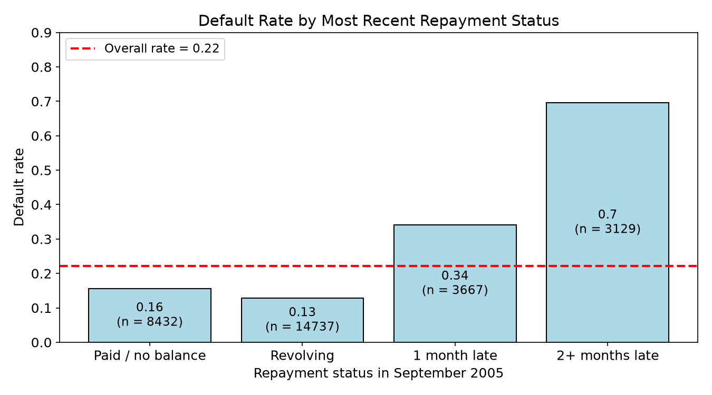
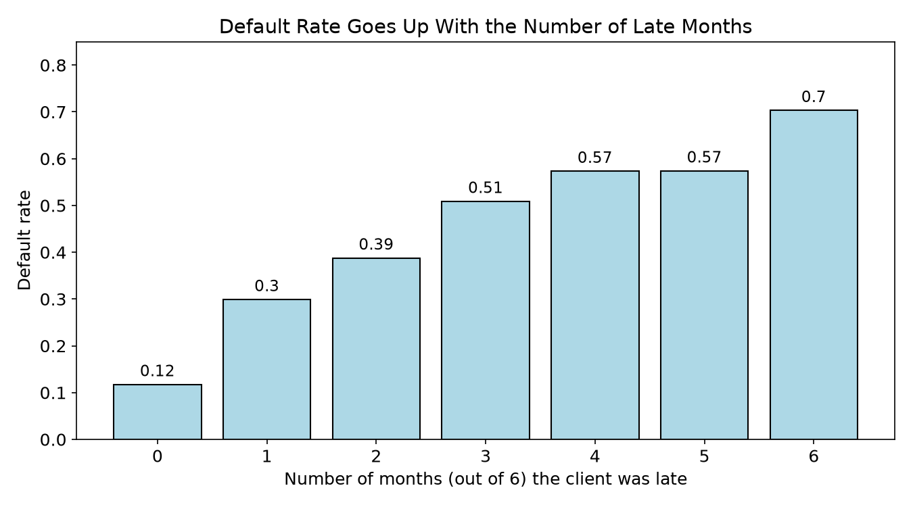
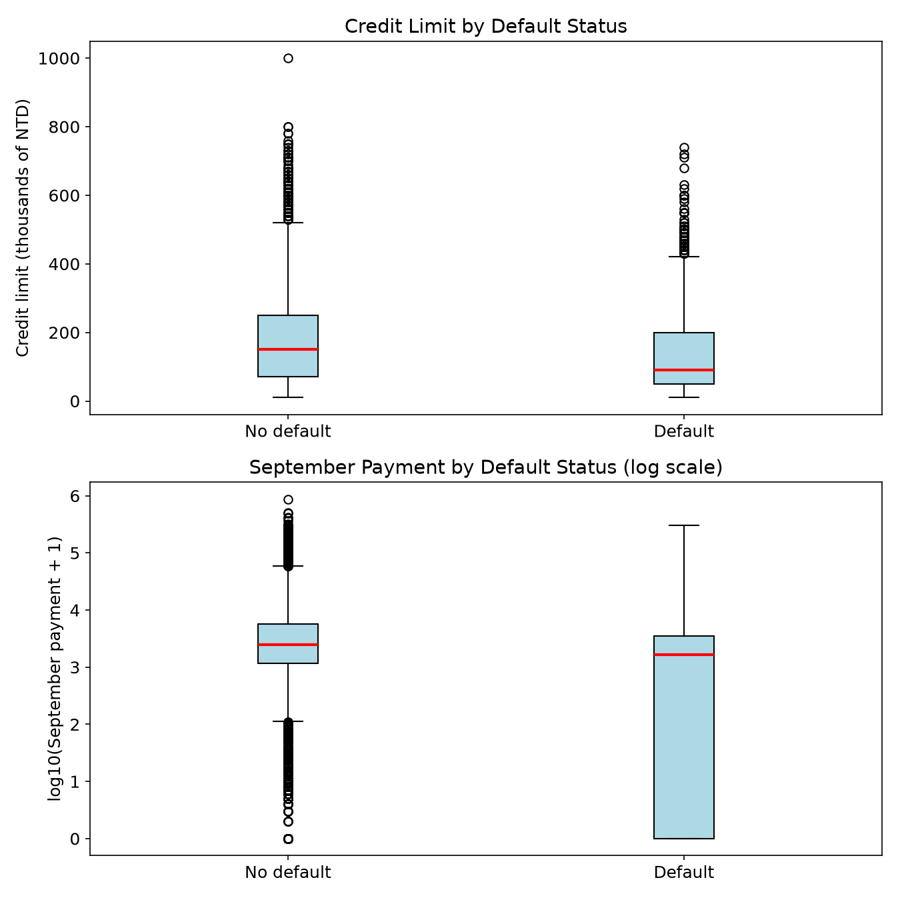
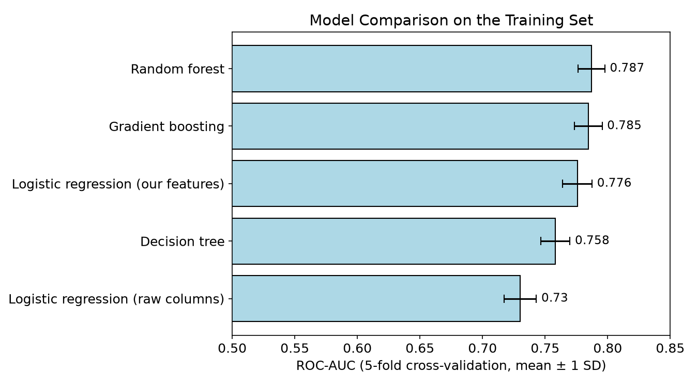
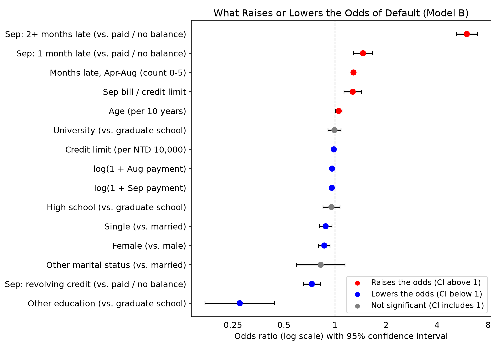
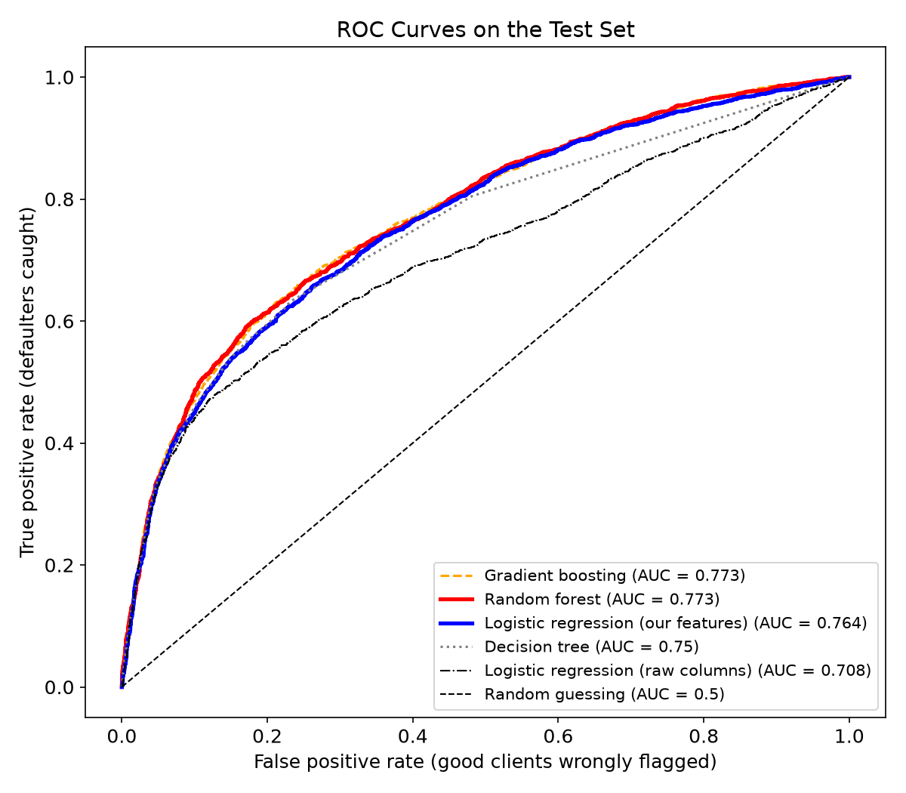
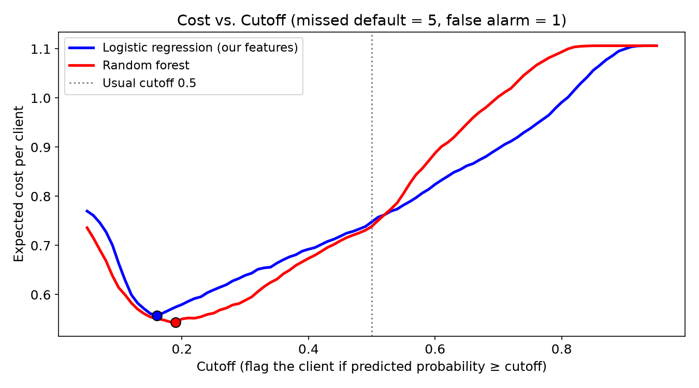
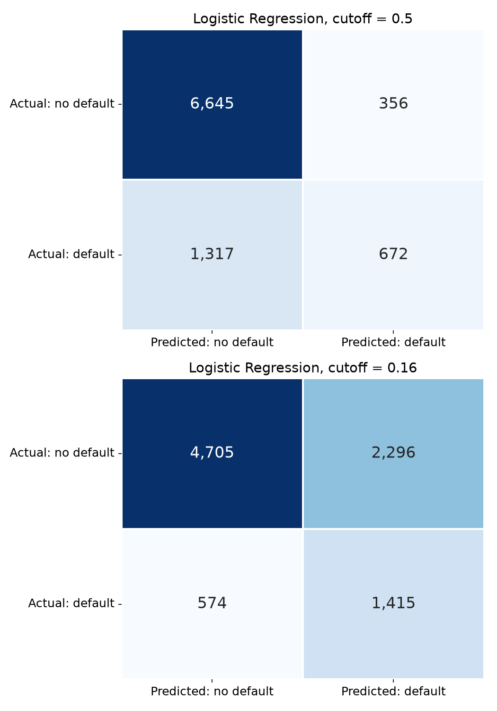
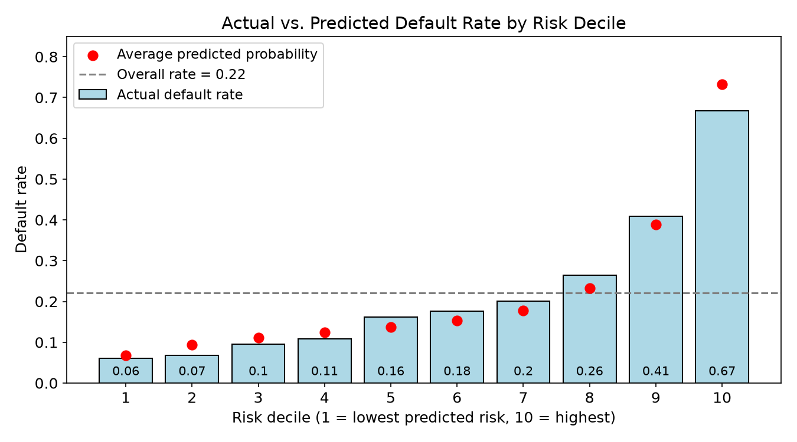

# Predicting Credit Card Payment Default Using Client Demographics and Payment History

**AAI-500: Probability and Statistics for Artificial Intelligence**

University of San Diego, Shiley-Marcos School of Engineering

**Final Team Project, Group 02**

Abhineet Sood

Ravi Kanth Vuddagiri

October 4, 2026

GitHub repository: https://github.com/asood-usd/AAI500-credit-default

## 1. Introduction

When a credit card client stops paying, the bank loses the unpaid balance. If the bank could spot risky
clients a month early, it could do something before the loss happens, like send a reminder, offer a
payment plan, or hold off on a limit increase. The question is which clients to focus on.

For this project we used the **Default of Credit Card Clients** dataset from the UCI Machine Learning
Repository (Yeh & Lien, 2009). It has **30,000 clients of a bank in Taiwan** from April to September 2005.
For each client we know the credit limit, four demographic variables (sex, education, marital status,
age), and six months of history: the repayment status, the bill amount, and the amount paid each month.
The target is whether the client **defaulted on the October 2005 payment**. About 22% did.

We wanted to answer three questions:

1. **Which factors are related to default, and how strongly?** We used chi-squared tests, t tests, a
   two-proportion z test and confidence intervals, like in Modules 4 and 5.
2. **How well can we predict default?** Our main model is a logistic regression, because its
   coefficients can be explained as odds ratios. We compared it with a decision tree, a random forest
   and gradient boosting.
3. **How should a bank use the predictions?** We chose a cutoff based on what each kind of mistake costs,
   instead of using the usual 0.5.

**Main result.** How a client has been paying matters much more than who the client is. A client who was
two or more months late in September has about **6 times the odds** of defaulting compared with a client
who paid in full, after accounting for everything else. Our logistic regression reaches a test ROC-AUC of
**0.764**, only about 0.01 below the best model (a random forest, 0.773). With a cost-based cutoff it
catches **71% of defaulters** instead of 34%, and lowers the expected cost by about **25%**.

## 2. Data Cleaning and Preparation

### 2.1 Data quality checks

The raw file has 30,000 rows and 25 columns (an ID, 23 predictors and the target). We checked for missing
values, duplicates, and category codes that don't match the dataset documentation.

- **Missing values:** none.
- **Duplicates:** 35 rows are exact copies of another row once the ID column is removed.
- **Undocumented codes:** the documentation lists EDUCATION as 1–4 and MARRIAGE as 1–3, but the data also
  has EDUCATION = 0, 5, 6 (345 rows) and MARRIAGE = 0 (54 rows).
- **Repayment status codes:** the documentation describes -1 (paid on time) and 1–9 (months late), but most
  values are actually -2 and 0. Other studies of this data read -2 as "no balance / card not used" and 0 as
  "revolving credit" (paid the minimum, not late). These are real account states, not errors.

### 2.2 Cleaning decisions

**Table 1.** Cleaning steps (in `src/cleaning.py`).

| Issue | Rows | Action | Why |
|---|---|---|---|
| `ID` column | all | Dropped | It's just a row number |
| Exact duplicates (ignoring ID) | 35 | Dropped | Would count the same client twice |
| `EDUCATION` = 0, 5, 6 | 345 | Changed to 4 ("Other") | Undocumented and rare (1.2%) |
| `MARRIAGE` = 0 | 54 | Changed to 3 ("Other") | Undocumented and rare (0.2%) |
| `PAY_*` = -2, 0 | many | Kept | Real states (no balance, revolving) |
| `PAY_0` column name | n/a | Renamed `PAY_1` | Lines up with `BILL_AMT1` and `PAY_AMT1` |
| Target name | n/a | Renamed `DEFAULT` | Shorter |

We **kept the outliers**. Very large credit limits (up to NTD 1,000,000) and payments are believable for
wealthy clients. Also, 1,930 clients have at least one negative bill, which means they overpaid and had a
credit balance. Removing them would throw away real clients.

The clean data has **29,965 rows and 24 columns**, with a **22.13% default rate** (6,630 defaults).

### 2.3 Feature engineering

For the logistic regression we built 15 features (`src/features.py`). Each choice comes from something we
found in the exploratory analysis (Section 3).

**Table 2.** Features used in the logistic regression.

| Feature | How we built it | Why |
|---|---|---|
| Credit limit | `LIMIT_BAL` / 10,000 | Odds ratio per NTD 10,000 is easier to read |
| Age | `AGE` / 10 | Odds ratio per 10 years |
| Sex, education, marital status | 0/1 dummies | Reference groups: male, graduate school, married |
| September status | 4 groups: paid / no balance (-2, -1), revolving (0), 1 month late, 2+ months late | Strongest predictor; codes 3–8 are rare |
| Months late, Apr–Aug | Count of `PAY_2`…`PAY_6` ≥ 1 | Replaces 5 correlated columns |
| Utilization | `BILL_AMT1` / `LIMIT_BAL`, kept between -1 and 3 | Replaces 6 bill columns with VIF 10–16 |
| Recent payments | log(1 + `PAY_AMT1`), log(1 + `PAY_AMT2`) | Payments are very skewed right |

The tree models used the 23 cleaned columns directly, since trees don't need dummies or logs.

### 2.4 Train/test split

We split the data **70% / 30%** (20,975 training and 8,990 test clients), the same split suggested in
Module 5. The split is **stratified**, so both parts keep the 22% default rate, and it uses a fixed random
seed (500). We made every modeling choice, including the cutoff, using **5-fold cross-validation on the
training set only**. We used the test set once, at the end.

## 3. Exploratory Data Analysis

### 3.1 How many clients defaulted?

Only **22.13%** of clients defaulted. A model that always predicts "no default" would already be about 78%
accurate, so accuracy by itself is misleading here. We looked at ROC-AUC, precision and recall instead.

### 3.2 Repayment history

September repayment status is the strongest single pattern in the data (Figure 1). Clients who paid in
full or carried a normal revolving balance defaulted 13–16% of the time. One month late raises that to
**34%**, and two or more months late to **70%**. The chi-squared test of independence gives χ² = 5,333.29
with df = 3 and P ≈ 0.

**Figure 1.** Default rate by September repayment status. The dashed line is the overall rate.

Looking at all six months shows the same thing (Figure 2). Clients who were never late defaulted **12%**
of the time, and clients who were late in all six months defaulted **70%** of the time.

**Figure 2.** Default rate by the number of months (out of six) a client was at least one month late.

### 3.3 Credit limit, payments and bills

For each numeric variable we ran a two-sample t test with `equal_var=False` and found the 95% CI for the
difference in means (Table 3). The dollar amounts are very skewed, so, like the house prices in Module 4,
we also ran the same test on log(1 + amount). It gave the same conclusions every time.

**Table 3.** Difference in means (default − no default), with 95% CIs.

| Variable | Mean, no default | Mean, default | Difference (95% CI) | P-value |
|---|---|---|---|---|
| Credit limit (NTD) | 178,085 | 129,985 | -48,100 (-51,349 to -44,851) | < 0.001 |
| September payment (NTD) | 6,315 | 3,400 | -2,915 (-3,241 to -2,589) | < 0.001 |
| August payment (NTD) | 6,649 | 3,392 | -3,257 (-3,687 to -2,826) | < 0.001 |
| September bill (NTD) | 52,059 | 48,553 | -3,506 (-5,518 to -1,494) | < 0.001 |
| Age (years) | 35.42 | 35.72 | 0.30 (0.04 to 0.56) | 0.02 |

Defaulters had **lower credit limits** and **paid about half as much** (Figure 3). In September, **28% of
defaulters paid nothing at all**, compared with 14% of non-defaulters. The bill difference is significant,
but it's only about 7% of the average bill. **Age** is significant at α = 0.05, but the difference is only
0.30 years (about 3 to 4 months), which is too small to matter in practice.

**Figure 3.** Credit limit (top) and September payment on a log scale (bottom), by default status. Red
lines are medians.

### 3.4 Demographics

Sex, education, marital status and age group are all related to default (all chi-squared P-values below
0.001), but mostly because the sample is so large. The default rates only differ by about 0.03 to 0.06
between groups (education looks bigger only because of the small "Other" group). For example, men
defaulted 24.16% of the time and women 20.79%. A two-proportion z test gives z = 6.88 (P < 0.001), and the
95% CI for the difference is **2.40 to 4.34 percentage points**. The gap is real, but small next to the 20
to 50 point jumps that come with repayment status.

### 3.5 Correlation and multicollinearity

The six monthly bill amounts are very highly correlated with each other (r = 0.80 to 0.95), and their
**variance inflation factors (VIF) are 10 to 16**, above the usual cutoff of 5 to 10. The six repayment
status columns are also correlated (r = 0.48 to 0.82). If we put all of these into a logistic regression,
we couldn't trust the coefficients. That's why we summarized them (Table 2). After that, **every VIF is
below 2.2**.

## 4. Model Selection

### 4.1 Logistic regression: does payment behavior add information?

Logistic regression models the log-odds of default as a linear function of the features. `statsmodels`
fits it by **maximum likelihood**, the same idea as the likelihood function in Module 4, just with 16
parameters. Each coefficient β turns into an **odds ratio** e^β: how much the odds of default get
multiplied when that feature goes up by 1 and the others stay the same.

We fit two models on the training set:

- **Model A (profile only):** credit limit, age, sex, education, marital status (8 features).
- **Model B (profile + behavior):** Model A plus September status, the count of earlier late months,
  utilization and the two payment amounts (15 features).

We compared them with a **likelihood ratio test**. H₀ says the seven behavior coefficients are all 0. The
test statistic is LR = 2(ℓ_B − ℓ_A) = **3,352.19 with df = 7, P ≈ 0**, so we reject H₀. Model B also has a
much lower AIC (**18,133.15 vs. 21,471.34**), and its pseudo R² goes up from **0.03 to 0.18**. The profile
by itself explains very little; payment behavior is what makes the model work. We used Model B from here on.

### 4.2 Comparison models

To see what we give up by using a simple model we can explain, we compared four other models:

- **Logistic regression on all 23 raw columns**, to check whether our feature work helped.
- **Decision tree** (max depth 5, at least 50 clients per leaf).
- **Random forest** (300 trees). We tried leaf sizes of 5, 10, 25, 50 and 100 with cross-validation.
  Sizes 25 to 100 all scored about the same, and 50 was the highest.
- **Gradient boosting** (scikit-learn's `HistGradientBoostingClassifier`, the same idea as XGBoost).

We scored every model with **5-fold stratified cross-validation ROC-AUC** on the training set. ROC-AUC is
the chance that the model gives a random defaulter a higher score than a random non-defaulter. It doesn't
depend on a cutoff, so it's a fair way to compare models when only 22% of clients default.

**Figure 4.** Cross-validated ROC-AUC on the training set (mean ± 1 SD across the 5 folds).

The random forest (0.787) and gradient boosting (0.785) scored highest. Our logistic regression (0.776)
was about **0.011 lower**, roughly one fold-to-fold SD. The same logistic regression on the raw columns
scored only **0.730**. So **our feature work helped more (+0.046) than switching to a more complex model
(+0.011)**.

We took two finalists into the evaluation: the **logistic regression** (the model we can explain) and the
**random forest** (the best score).

## 5. Model Analysis

### 5.1 What drives default: odds ratios

**Figure 5.** Odds ratios from Model B with 95% confidence intervals (log scale). Red raises the odds,
blue lowers them, gray is not significant.

**Table 4.** Selected odds ratios from Model B (the full table is in `reports/tables/odds_ratios.csv`).

| Feature | Odds ratio | 95% CI | P-value |
|---|---|---|---|
| Sep: 2+ months late (vs. paid / no balance) | **5.99** | 5.19 to 6.91 | < 0.001 |
| Sep: 1 month late | 1.46 | 1.29 to 1.66 | < 0.001 |
| Each earlier late month (Apr–Aug) | 1.29 | 1.25 to 1.33 | < 0.001 |
| Utilization (bill / limit) | 1.27 | 1.13 to 1.43 | < 0.001 |
| Credit limit, per NTD 10,000 | 0.983 | 0.980 to 0.987 | < 0.001 |
| log(1 + Sep payment) | 0.958 | 0.946 to 0.970 | < 0.001 |
| Sep: revolving credit | 0.73 | 0.65 to 0.82 | < 0.001 |
| Female (vs. male) | 0.87 | 0.80 to 0.93 | < 0.001 |
| Single (vs. married) | 0.88 | 0.81 to 0.96 | 0.004 |
| Age, per 10 years | 1.05 | 1.00 to 1.10 | 0.032 |
| University (vs. graduate school) | 0.99 | 0.91 to 1.08 | 0.872 |

What the main results mean:

- **Recent lateness matters most.** Being 2+ months late in September multiplies the odds by about 6. A
  client who was late in all five earlier months has about 1.29⁵ ≈ **3.5 times** the odds of one who was
  never late.
- **Credit limit:** NTD 100,000 more limit gives 0.983¹⁰ ≈ **0.84**, about 16% lower odds. Part of this is
  probably because the bank already gives bigger limits to clients it trusts.
- **Payments:** paying 10 times more in September lowers the odds by about 9%.
- **Revolving vs. paid in full:** revolving clients have lower odds than the "paid / no balance" group. This
  surprised us. We think it's because code -2 includes inactive cards, which may behave differently.
- **Demographics** have small effects. Education (other than the small "Other" group, which includes the
  undocumented codes we merged) is not significant once payment behavior is in the model.

**Do we need demographics at all?** We refit the model without sex, marital status and age. The test AUC
went from **0.7637 to 0.7636**. These variables add basically nothing to the predictions, so a bank could
leave them out. That matters for fairness and legal reasons.

The random forest agrees. Its six most important columns are the six monthly repayment statuses, with
September (PAY_1) far ahead of the rest, followed by the September payment, credit limit and bill. No
demographic variable makes its top 10. Two very different models agreeing on what matters makes us more
confident in this finding.

### 5.2 Test-set performance

**Table 5.** Test-set results (8,990 clients) at the usual 0.5 cutoff.

| Model | ROC-AUC | Accuracy | Precision | Recall | F1 |
|---|---|---|---|---|---|
| Gradient boosting | 0.773 | 0.816 | 0.658 | 0.355 | 0.461 |
| Random forest | 0.773 | 0.814 | 0.652 | 0.346 | 0.452 |
| **Logistic regression (our features)** | **0.764** | 0.814 | 0.654 | 0.338 | 0.445 |
| Decision tree | 0.750 | 0.815 | 0.664 | 0.332 | 0.443 |
| Logistic regression (raw columns) | 0.708 | 0.807 | 0.679 | 0.242 | 0.357 |

The test AUCs are close to the cross-validation scores, so the models weren't overfit (Figure 6). At the
0.5 cutoff, though, every model **only flags about a third of the defaulters**. Section 5.4 fixes this.

**Figure 6.** ROC curves on the test set.

### 5.3 Is the random forest really better?

We bootstrapped the test set 2,000 times and recomputed both AUCs on the same resampled clients each time.
The 95% CI for the random forest's advantage is **0.003 to 0.015**, and the random forest is higher in 99.8%
of the resamples. So the difference is real, but at about **0.01 AUC it's small in practice**.

### 5.4 Choosing a cutoff

A 0.5 cutoff treats both kinds of mistakes as equally bad. For a bank, missing a defaulter (losing the
balance; the median September bill among defaulters was about NTD 20,000) is much worse than a false
alarm (a reminder call or a temporary hold for a good client). We **assumed a missed default costs 5 times
as much as a false alarm**, and picked the cutoff with the lowest expected cost on the **out-of-fold
training predictions**.

**Figure 7.** Expected cost per client vs. cutoff (training set, out-of-fold predictions).

The best cutoff was **0.16** for the logistic regression and **0.19** for the random forest. This matches
theory: if the probabilities are accurate, flagging a client is worth it when p × 5 > (1 − p) × 1, which
works out to p > 1/6 ≈ 0.17 (Elkan, 2001).

**Table 6.** Logistic regression on the test set at 0.5 vs. the cost-based cutoff.

| Cutoff | Precision | Recall | Clients flagged | Expected cost per client |
|---|---|---|---|---|
| 0.50 | 0.65 | 0.34 | 11% | 0.772 |
| **0.16** | 0.38 | **0.71** | 41% | **0.575** |

Lowering the cutoff **doubles the share of defaulters caught (34% → 71%)** and lowers the expected cost by
about **25%**. The random forest at its own cutoff costs 0.567 per client, about 1.4% less than the logistic
regression.

**Figure 8.** Logistic regression confusion matrices on the test set at cutoffs 0.5 and 0.16.

**How much does the cost assumption matter?** We don't know the bank's real costs, so we repeated the
search for other ratios (Table 7). The cutoff moves a lot, and each time it's close to the theory value
1 / (1 + ratio). A bank would use its own numbers; the model itself stays the same.

**Table 7.** Best cutoff for different cost ratios (logistic regression, test-set results).

| Cost ratio (miss : false alarm) | Cutoff | Clients flagged | Recall | Precision |
|---|---|---|---|---|
| 2 : 1 | 0.34 | 16% | 43% | 58% |
| 3 : 1 | 0.23 | 25% | 55% | 49% |
| 5 : 1 | 0.16 | 41% | 71% | 38% |
| 10 : 1 | 0.11 | 76% | 92% | 27% |

### 5.5 Does the model sort clients well?

We sorted the test clients into ten equal groups by predicted risk (Figure 9). The lowest-risk 10% default
only **6%** of the time, and the highest-risk 10% default **67%** of the time. The **top 20% of clients by
predicted risk include 49% of all defaulters**. The model's average predicted probability in each group is
close to the actual default rate, so the probabilities can be used about as they are. The biggest gap is in
the riskiest group (predicted 0.73, actual 0.67).

**Figure 9.** Actual default rate (bars) and average predicted probability (dots) for each risk decile
(logistic regression, test set).

## 6. Conclusion and Recommendations

### 6.1 Conclusions

1. **How a client pays matters much more than who the client is.** Recent lateness is the strongest
   warning sign (odds ratio about 6 for 2+ months late in September), followed by a history of late months,
   low payments, high utilization and a low credit limit.
2. **Demographics add almost nothing.** Sex, education, marital status and age are statistically
   significant because the sample is large, but their effects are small. Taking out sex, marital status and
   age changes the test AUC by only 0.0001.
3. **A simple model is almost as good as a complex one.** Logistic regression with good features got a
   test AUC of 0.764, vs. 0.773 for the random forest. Our feature work mattered more than the choice of
   model.
4. **The cutoff matters as much as the model.** A cost-based cutoff of 0.16 doubles the share of
   defaulters caught and lowers the expected cost by about 25% compared with 0.5.

### 6.2 Recommendations for a bank

- **Use the logistic regression as the main model.** It gives up only about 0.01 AUC and 1.4% in expected
  cost compared with the random forest, but every prediction can be explained ("two months late in
  September multiplies the odds by about 6"). Like the Bayesian network question in Module 5, a model the
  bank can explain is easier to check, explain to clients and regulators, and act on. Keep the random
  forest as a benchmark.
- **Watch payment behavior every month.** A missed or late payment should trigger early, low-cost contact
  like a reminder or a payment-plan offer, before a second month of lateness.
- **Act in tiers.** Clients in the top risk decile (67% default rate) should get stronger steps, like a
  personal call or holding limit increases. Clients above the cost-based cutoff get reminders. Low-risk
  clients are left alone.
- **Set the cutoff from real costs.** Our 5 : 1 ratio is an assumption. The bank should estimate the real
  cost of a missed default and of a false alarm, and recompute the cutoff (Table 7).
- **Leave out sex, marital status and age.** They barely help the predictions and could raise fairness or
  legal problems.

### 6.3 Limitations and future work

- **Old, local data.** The data is from one bank in Taiwan in 2005, during a credit card debt crisis there.
  Default patterns today, or in other countries, may be different.
- **Short history.** Six months of history and one outcome month limit what the model can learn about
  longer-term behavior.
- **Assumed costs.** The 5 : 1 cost ratio is our assumption, not the bank's real number.
- **Unclear codes.** The meaning of repayment codes -2 and 0, and of the undocumented education and marital
  codes, comes from other studies, not from the data provider.
- **Future work:** add income or other financial data if we can get it, test on more recent data, and check
  fairness directly (for example, compare recall for men and women).

## Team Contributions

This was a team effort. We met regularly, shared ideas, and made the main analysis decisions together.
**Abhineet Sood** set up the repository and most of the code: data loading, cleaning, feature engineering,
and the modeling and evaluation notebooks. **Ravi Kanth Vuddagiri** led the technical report and the video
presentation. We both reviewed each other's work.

## References

Agresti, A., & Kateri, M. (2022). *Foundations of statistics for data scientists: With R and Python*. CRC
Press.

Elkan, C. (2001). The foundations of cost-sensitive learning. In *Proceedings of the Seventeenth
International Joint Conference on Artificial Intelligence* (pp. 973–978). Morgan Kaufmann.

Pedregosa, F., Varoquaux, G., Gramfort, A., Michel, V., Thirion, B., Grisel, O., Blondel, M., Prettenhofer,
P., Weiss, R., Dubourg, V., Vanderplas, J., Passos, A., Cournapeau, D., Brucher, M., Perrot, M., &
Duchesnay, É. (2011). Scikit-learn: Machine learning in Python. *Journal of Machine Learning Research, 12*,
2825–2830.

Seabold, S., & Perktold, J. (2010). Statsmodels: Econometric and statistical modeling with Python. In
*Proceedings of the 9th Python in Science Conference* (pp. 92–96).

Yeh, I.-C. (2009). *Default of credit card clients* [Data set]. UCI Machine Learning Repository.
https://doi.org/10.24432/C55S3H

Yeh, I.-C., & Lien, C.-H. (2009). The comparisons of data mining techniques for the predictive accuracy of
probability of default of credit card clients. *Expert Systems with Applications, 36*(2), 2473–2480.
https://doi.org/10.1016/j.eswa.2007.12.020

## Use of Generative AI Tools — Disclosure

**Tool used:** Claude (Anthropic), accessed through Claude Code.

**Purpose of use:** We used Claude as a coding and writing partner for this project.

**What we implemented and modified:** We planned the analysis and made the decisions together (how to treat
the undocumented codes, which features to build, which model to recommend, and the cost assumption). We
used AI's help to set up the repository, fix Python syntax, and polish the wording of this report. We ran
every notebook ourselves and checked that each number in the report matches the notebook output.

## Appendix: Notebook Output

The following pages have the executed notebooks from the GitHub repository, in order:

- A. `01_data_prep_eda.ipynb`: loading, quality checks, cleaning, first look at the data
- B. `02_eda_statistical_tests.ipynb`: chi-squared tests, z test, t tests, correlation, VIF
- C. `03_modeling.ipynb`: features, logistic regression, likelihood ratio test, model comparison
- D. `04_evaluation.ipynb`: test-set results, bootstrap, cost-based cutoff, risk deciles
